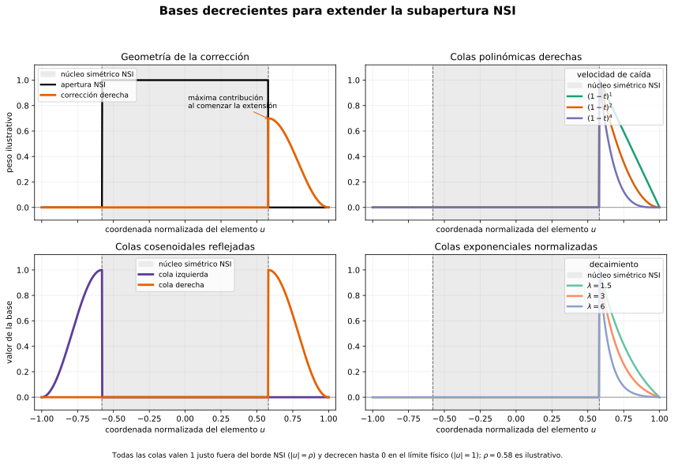

# NSI con perturbación residual aprendida

## Objetivo

Partir de Null Subtraction Imaging (NSI) como beamformer analítico conocido y aprender únicamente una corrección pequeña de sus apodizaciones. La motivación no es reemplazar NSI desde cero, sino compensar de forma controlada la degradación que aparece cuando una subapertura simétrica queda truncada cerca de los bordes de la sonda.

La hipótesis verificable es:

> Una perturbación geométrica aprendida, inicialmente nula y aplicada sobre NSI, puede recuperar información de la apertura físicamente disponible cerca de los bordes sin degradar el comportamiento de NSI en el interior.

## NSI como solución base

Para las sumas complejas de las dos semisubaperturas,

$$
L=\sum_{e\in\mathcal A_L}s_e,
\qquad
R=\sum_{e\in\mathcal A_R}s_e,
$$

se definen

$$
S=L+R,
\qquad
D=R-L.
$$

La reconstrucción NSI empleada es

$$
I_{\mathrm{NSI}}
=
\frac{1}{2}|D+dS|
+
\frac{1}{2}|-D+dS|
-|D|,
$$

donde $d$ es el término `dc`.

Esto puede expresarse como tres canales analíticos:

$$
A_1=D+dS,
\qquad
A_2=-D+dS,
\qquad
A_3=D,
$$

con mezcla fija

$$
I_{\mathrm{NSI}}
=
\frac{1}{2}|A_1|
+
\frac{1}{2}|A_2|
-|A_3|.
$$

Por tanto, NSI es una inicialización exacta: si no se aprende corrección alguna, el método propuesto debe reproducirlo exactamente.

## Apodizaciones residuales

Para cada canal $c$, la apodización propuesta es

$$
w_c(e;x,z)
=
w_c^{\mathrm{NSI}}(e;x,z)
+
\varepsilon\,\Delta w_c(e;x,z),
$$

donde $w_c^{\mathrm{NSI}}$ es la apodización analítica de NSI, $\Delta w_c$ es la perturbación aprendida y $\varepsilon$ limita su magnitud.

La condición inicial deseada es

$$
\Delta w_c=0
\quad\Longrightarrow\quad
w_c=w_c^{\mathrm{NSI}}.
$$

Así, cualquier ganancia frente a NSI puede atribuirse explícitamente a la perturbación y no a que la red haya redescubierto una aproximación incompleta de NSI.

## MLP para coeficientes de una base

La MLP no debe predecir un peso independiente para cada elemento. Debe predecir pocos coeficientes $\alpha_{c,k}$ que combinan una base fija de perfiles sobre la apertura:

$$
\alpha_{c,k}(x,z)
=
\operatorname{MLP}_{\theta}(\phi(x,z))_{c,k},
$$

$$
\Delta w_c(e;x,z)
=
\sum_{k=1}^{K}
\alpha_{c,k}(x,z)
b_k\!\left(u_e\right),
$$

con coordenada de elemento normalizada

$$
u_e=\frac{x_e-x}{W(x,z)}.
$$

Por ejemplo, con tres canales NSI y ocho funciones base, la salida de la MLP por píxel es sólo $3\times8=24$ coeficientes. El perfil por elemento se reconstruye algebraicamente a partir de esos coeficientes.

Las entradas geométricas $\phi$ deberían incluir profundidad, posición lateral normalizada, $F\#$, distancia a los bordes izquierdo y derecho, número de elementos disponibles a cada lado y fracción de apertura ideal perdida. La MLP se evalúa una vez por píxel, no una vez por elemento.

## Bases iniciales

Las funciones $b_k$ deben ser fijas e interpretables en la primera versión. Para corregir el truncamiento de NSI, no resulta adecuado utilizar como bases principales polinomios globales ni rampas que crezcan hacia el extremo físico. Esas funciones dan cada vez más peso a los elementos más alejados del píxel, al contrario de la prioridad física buscada.

La corrección debe comenzar inmediatamente fuera del borde de la subapertura NSI: los primeros elementos añadidos reciben la mayor contribución y ésta decrece al aumentar la distancia lateral al píxel.

Sea $a_{\mathrm{NSI}}(x,z)$ el semiancho de la subapertura simétrica y $a_{\mathrm{avail},R}(x,z)$ el alcance físicamente disponible hacia la derecha. Para un elemento exterior al núcleo NSI se define

$$
t_R(e;x,z)
=
\frac{(x_e-x)-a_{\mathrm{NSI}}}
{a_{\mathrm{avail},R}-a_{\mathrm{NSI}}},
\qquad 0<t_R\leq1.
$$

Una familia sencilla de colas polinómicas es

$$
b_{R,p}(e;x,z)
=
\mathbf 1_{(0,1]}(t_R)(1-t_R)^p,
\qquad p\in\{1,2,4\}.
$$

El exponente controla la longitud efectiva de la extensión: $p=1$ genera una cola larga y $p=4$ concentra la corrección en los elementos más próximos al borde NSI.

Una alternativa con pendiente nula en ambos extremos es la cola cosenoidal:

$$
b_{R,\cos}(e;x,z)
=
\mathbf 1_{(0,1]}(t_R)
\frac{1+\cos(\pi t_R)}{2}.
$$

También pueden emplearse exponenciales normalizadas para llegar exactamente a cero en el límite físico:

$$
b_{R,\lambda}(e;x,z)
=
\mathbf 1_{(0,1]}(t_R)
\frac{e^{-\lambda t_R}-e^{-\lambda}}
{1-e^{-\lambda}}.
$$

Las bases izquierdas son el reflejo geométrico de las derechas. La MLP predice coeficientes separados para ambos lados:

$$
\Delta w_c(e;x,z)
=
\sum_k\alpha^L_{c,k}(x,z)b_{L,k}(e;x,z)
+
\sum_k\alpha^R_{c,k}(x,z)b_{R,k}(e;x,z).
$$

Así, la red selecciona el lado de extensión, la amplitud y la rapidez de caída, mientras que las bases incorporan explícitamente que la contribución debe disminuir al alejarnos del píxel.

La figura utiliza $\rho=0.58$ únicamente para visualizar un núcleo NSI normalizado. En la aplicación real, el borde de ese núcleo y el espacio físicamente disponible dependen de $(x,z)$.

## Corrección de borde y apertura asimétrica

NSI limita la semisubapertura al máximo tamaño simétrico posible. Cerca de un borde, esto descarta elementos que existen del lado interior de la sonda.

Si la perturbación sólo actúa dentro de la apertura simétrica ya recortada, puede redistribuir pesos y compensar parcialmente ganancia, pero no recupera la información descartada. Para atacar la causa geométrica, la región sobre la que se define $\Delta w_c$ debe permitir

$$
\mathcal A_{\mathrm{learned}}
\supseteq
\mathcal A_{\mathrm{NSI,symmetric}}.
$$

Una puerta geométrica puede mantener la corrección inactiva cuando la apertura ideal cabe completamente en la sonda:

$$
w_c
=
w_c^{\mathrm{NSI}}
+
g(x,z)
\sum_k\alpha_{c,k}(x,z)b_k(u),
$$

donde $g(x,z)\approx0$ cuando la apertura ideal cabe en la sonda y crece al aproximarse a un borde. La parametrización de la puerta debe respetar la simetría por reflexión: una situación equivalente en el borde izquierdo y derecho debe producir correcciones reflejadas.

## Separar forma de PSF y ganancia

La corrección puede mejorar simplemente la amplitud cuando disminuye el número de elementos. Para no confundir esa compensación con una mejora de resolución, conviene descomponer

$$
\Delta w_c
=
\Delta w_c^{\mathrm{shape}}
+
\beta_c w_c^{\mathrm{gain}}.
$$

En una primera etapa se puede imponer

$$
\sum_e\Delta w_c^{\mathrm{shape}}(e;x,z)=0,
$$

de modo que la perturbación de forma no introduzca ganancia DC libre. La compensación de ganancia $\beta_c$ se añade después como una ablación explícita.

## Inicialización y restricciones

Una salida acotada facilita preservar NSI al inicio:

$$
\alpha_{c,k}
=
\varepsilon\tanh\!\left(
\operatorname{MLP}_{\theta}(\phi)_{c,k}
\right).
$$

La última capa de la MLP debe inicializarse a cero. Entonces $\alpha_{c,k}=0$ inicialmente y la salida completa equivale a NSI.

## Función de pérdida

La función de pérdida debe cumplir dos objetivos diferentes: mejorar la imagen en la región donde NSI falla y, al mismo tiempo, impedir que la solución se aleje innecesariamente de NSI. Una formulación completa puede escribirse como

$$
\mathcal L
=
\mathcal L_{\mathrm{imagen}}
+
\lambda_r\mathcal L_{\mathrm{res}}
+
\lambda_s\mathcal L_{\mathrm{smooth}}
+
\lambda_{\mathrm{sym}}\mathcal L_{\mathrm{symmetry}}
+
\lambda_{\mathrm{DC}}\mathcal L_{\mathrm{DC}}
+
\lambda_{\mathrm{int}}\mathcal L_{\mathrm{interior}}.
$$

Los coeficientes $\lambda$ no representan propiedades físicas: fijan el compromiso entre fidelidad de imagen y restricciones del modelo. Cada término debe normalizarse para que su magnitud no dependa arbitrariamente del número de píxeles, elementos o canales.

### Pérdida de imagen

$\mathcal L_{\mathrm{imagen}}$ es el término que proporciona la señal de aprendizaje principal. Compara la salida $I_{\mathrm{out}}$ con una referencia $I_{\mathrm{ref}}$ y determina qué significa realmente «mejorar NSI».

No conviene usar únicamente error en amplitud lineal: los reflectores intensos dominarían el gradiente y el fondo tendría poca influencia. Tampoco conviene usar únicamente amplitud logarítmica: pequeñas diferencias próximas al suelo de ruido podrían adquirir demasiado peso. Una combinación posible es

$$
\mathcal L_{\mathrm{imagen}}
=
\lambda_{\mathrm{lin}}\mathcal L_{\mathrm{lin}}
+
\lambda_{\log}\mathcal L_{\log}
+
\lambda_{\mathrm{PSF}}\mathcal L_{\mathrm{PSF}}.
$$

El término lineal preserva amplitudes:

$$
\mathcal L_{\mathrm{lin}}
=
\frac{1}{|\Omega|}
\sum_{(x,z)\in\Omega}
\left|
\frac{I_{\mathrm{out}}(x,z)-I_{\mathrm{ref}}(x,z)}
{A_{\mathrm{ref}}+\epsilon}
\right|,
$$

donde $A_{\mathrm{ref}}$ es una escala definida por imagen, por ejemplo el máximo de la referencia o un percentil robusto. Debe fijarse una única convención para evitar que la normalización elimine precisamente el error de ganancia que se quiere medir.

El término logarítmico compara el rango dinámico relevante para B-mode:

$$
\mathcal L_{\log}
=
\frac{1}{|\Omega|}
\sum_{(x,z)\in\Omega}
\left|
\log\!\left(I_{\mathrm{out}}(x,z)+\delta\right)
-
\log\!\left(I_{\mathrm{ref}}(x,z)+\delta\right)
\right|.
$$

$\delta$ fija el suelo de amplitud y evita que el logaritmo amplifique valores numéricamente irrelevantes. Este suelo debe corresponder al rango dinámico de evaluación, no elegirse sólo por estabilidad numérica.

$\mathcal L_{\mathrm{PSF}}$ se utiliza en escenas de reflectores aislados. FWHM no es una buena pérdida directa porque depende de cruces discretos del nivel de $-6$ dB. Es preferible usar aproximaciones diferenciables, por ejemplo

$$
\mathcal L_{\mathrm{PSF}}
=
\lambda_{\mathrm{main}}
\sum_{(x,z)\in\Omega_{\mathrm{main}}}
\left|
\widehat I_{\mathrm{out}}-widehat I_{\mathrm{ref}}
\right|
+
\lambda_{\mathrm{side}}
\frac{
\sum_{(x,z)\in\Omega_{\mathrm{side}}}I_{\mathrm{out}}^2
}{
\sum_{(x,z)\in\Omega_{\mathrm{main}}}I_{\mathrm{out}}^2+\epsilon
}.
$$

Aquí $\Omega_{\mathrm{main}}$ contiene el lóbulo principal, $\Omega_{\mathrm{side}}$ la región de lóbulos laterales y $\widehat I$ indica una PSF normalizada por su pico. El primer término controla la forma del lóbulo principal independientemente de la ganancia; el segundo penaliza energía lateral relativa. La fidelidad de amplitud absoluta permanece en $\mathcal L_{\mathrm{lin}}$.

La elección de $I_{\mathrm{ref}}$ es crítica. Reutilizar como referencia una imagen DAS multiplicada por máscaras gaussianas mantendría el problema del planteamiento original. La referencia debería proceder de un método de mayor calidad, una simulación con PSF objetivo físicamente justificada o una referencia específica de borde validada. Otra posibilidad es entrenar con pérdidas explícitas de PSF y contraste sin exigir una imagen ideal completa.

### Penalización de la perturbación residual

$\mathcal L_{\mathrm{res}}$ expresa la hipótesis central del método: NSI es la solución base y la red sólo debe apartarse de ella cuando la mejora de imagen lo justifique. Una versión relativa es

$$
\mathcal L_{\mathrm{res}}
=
\frac{1}{|\Omega|C}
\sum_{(x,z),c}
\frac{
\sum_e m(e;x,z)\left|\Delta w_c(e;x,z)\right|^2
}{
\sum_e m_{\mathrm{NSI}}(e;x,z)
\left|w_c^{\mathrm{NSI}}(e;x,z)\right|^2+\epsilon
}.
$$

$m$ es la máscara de elementos físicamente disponibles y $m_{\mathrm{NSI}}$ la máscara de la subapertura simétrica. La normalización evita que una misma perturbación absoluta sea considerada pequeña en aperturas cortas y grande en aperturas largas, o viceversa.

Es preferible penalizar el perfil reconstruido $\Delta w$ y no sólo los coeficientes $\alpha_{c,k}$. Si las bases no son ortogonales ni tienen la misma norma, coeficientes de igual magnitud pueden producir perturbaciones físicas muy diferentes.

Un $\lambda_r$ demasiado grande hace que el modelo permanezca prácticamente idéntico a NSI. Uno demasiado pequeño permite que la red abandone NSI y convierta el método en otra apodización aprendida sin interpretación residual.

### Suavidad geométrica

$\mathcal L_{\mathrm{smooth}}$ evita que píxeles próximos produzcan colas de apertura muy diferentes. Puede aplicarse a los coeficientes de la base:

$$
\mathcal L_{\mathrm{smooth},\alpha}
=
\frac{1}{|\Omega|CK}
\sum_{x,z,c,k}
\left[
\left|
\frac{\alpha_{c,k}(x+\Delta x,z)-\alpha_{c,k}(x,z)}{\Delta x}
\right|^2
+
\eta_z
\left|
\frac{\alpha_{c,k}(x,z+\Delta z)-\alpha_{c,k}(x,z)}{\Delta z}
\right|^2
\right].
$$

$\eta_z$ permite equilibrar las direcciones lateral y axial cuando sus escalas físicas o muestreos son diferentes. Las diferencias deben calcularse usando coordenadas físicas o coordenadas normalizadas, no índices de píxel sin corregir.

Suavizar sólo $\alpha$ no garantiza que los pesos finales sean continuos, porque la máscara de elementos activos cambia discretamente. Por ello puede añadirse

$$
\mathcal L_{\mathrm{smooth},w}
=
\operatorname{mean}_{p\sim q,c}
\left\|
\Delta w_c(\cdot;p)-
\mathcal R_{q\rightarrow p}\Delta w_c(\cdot;q)
\right\|_2^2,
$$

donde $p$ y $q$ son píxeles vecinos y $\mathcal R_{q\rightarrow p}$ expresa ambos perfiles en una coordenada de apertura normalizada común. En la práctica,

$$
\mathcal L_{\mathrm{smooth}}
=
\mathcal L_{\mathrm{smooth},\alpha}
+
\gamma_w\mathcal L_{\mathrm{smooth},w}.
$$

### Simetría izquierda-derecha

$\mathcal L_{\mathrm{symmetry}}$ impide aprender comportamientos distintos en situaciones que sólo se diferencian por una reflexión de la sonda. Para cada punto $(x,z)$ se considera su reflejo $(-x,z)$ y se invierte el orden de los elementos.

La simetría debe respetar la estructura de los canales NSI. Bajo una reflexión, $S$ se conserva y $D$ cambia de signo. Por tanto, los canales $A_1=D+dS$ y $A_2=-D+dS$ se intercambian, mientras que $A_3=D$ cambia de signo. Para las perturbaciones de los pesos:

$$
\begin{aligned}
\Delta w_1(e;x,z)
&\leftrightarrow
\Delta w_2(E-1-e;-x,z),\\
\Delta w_2(e;x,z)
&\leftrightarrow
\Delta w_1(E-1-e;-x,z),\\
\Delta w_3(e;x,z)
&\leftrightarrow
-\Delta w_3(E-1-e;-x,z).
\end{aligned}
$$

Si $\mathcal T$ representa esta transformación completa, puede escribirse

$$
\mathcal L_{\mathrm{symmetry}}
=
\operatorname{mean}_{x,z,c}
\left\|
\Delta w_c(\cdot;x,z)
-
\mathcal T[\Delta w]_c(\cdot;x,z)
\right\|_2^2.
$$

Esta restricción reduce los datos necesarios y evita que una distribución asimétrica del conjunto de entrenamiento produzca una preferencia artificial por uno de los bordes.

### Control de la componente DC

$\mathcal L_{\mathrm{DC}}$ separa cambios de forma de una simple compensación de amplitud. Para la rama denominada `shape` puede utilizarse

$$
\mathcal L_{\mathrm{DC}}
=
\frac{1}{|\Omega|C}
\sum_{x,z,c}
\left|
\sum_e m(e;x,z)
\Delta w_c^{\mathrm{shape}}(e;x,z)
\right|^2.
$$

Si este término es pequeño, la perturbación redistribuye pesos pero no añade libremente una componente constante. La compensación de ganancia debe representarse mediante la variable separada $\beta_c$ y evaluarse como una ablación. Esta separación permite determinar si la mejora procede de una PSF diferente o sólo de recuperar amplitud al aumentar el número de elementos.

### Conservación exacta de NSI en el interior

$\mathcal L_{\mathrm{interior}}$ penaliza cualquier corrección en píxeles cuya apertura ideal cabe completamente dentro de la sonda:

$$
\mathcal L_{\mathrm{interior}}
=
\frac{1}{|\Omega_{\mathrm{int}}|C}
\sum_{(x,z)\in\Omega_{\mathrm{int}},c}
\left\|\Delta w_c(\cdot;x,z)\right\|_2^2.
$$

Sin embargo, si la puerta geométrica se define de manera que $g(x,z)=0$ exactamente en el interior, este término es redundante: la arquitectura ya garantiza $I_{\mathrm{out}}=I_{\mathrm{NSI}}$ allí. Esa garantía estructural es preferible a confiar únicamente en una penalización blanda.

### Selección de los pesos de regularización

Los $\lambda$ deben seleccionarse con un conjunto de validación separado y mediante métricas físicas, no sólo por la pérdida total. Conviene registrar por separado todos los términos para detectar soluciones degeneradas. Por ejemplo:

- baja pérdida de imagen y gran $\mathcal L_{\mathrm{res}}$: el modelo mejora la referencia, pero ya no es una pequeña corrección de NSI;
- baja $\mathcal L_{\mathrm{res}}$ y ninguna mejora de PSF: la regularización residual es demasiado fuerte;
- baja pérdida lineal pero peor PSLR: se está recuperando ganancia a costa de lóbulos laterales;
- buena validación global pero alta $\mathcal L_{\mathrm{interior}}$: la red está modificando NSI donde no debería.

Una estrategia práctica es comenzar con $\lambda_r$, $\lambda_s$ y $\lambda_{\mathrm{sym}}$ suficientemente altos para conservar el régimen residual, verificar que los gradientes de $\mathcal L_{\mathrm{imagen}}$ producen una corrección medible y después ajustar cada coeficiente mediante ablaciones. Los valores numéricos no deberían transferirse entre datasets sin volver a comprobar las escalas de cada término.

## Revisión bibliográfica de la función de pérdida

Esta sección resume una revisión bibliográfica dirigida realizada en octubre de 2026. No es una revisión sistemática tipo PRISMA: se buscaron trabajos primarios estrechamente relacionados con NSI, apodizaciones aprendidas, beamforming diferenciable y pérdidas específicas para B-mode. El objetivo es distinguir qué componentes de la pérdida anterior tienen precedente directo, cuáles son adaptaciones razonables y cuáles constituyen propuestas específicas de este proyecto.

### Resultado general

La literatura respalda con bastante claridad cuatro decisiones:

1. entrenar a través de un beamformer diferenciable;
2. definir parte de la pérdida sobre imágenes B-mode log-comprimidas;
3. combinar fidelidad píxel a píxel con una medida estructural;
4. imponer restricciones físicas directamente sobre los pesos de apodización.

No se encontró un trabajo que proponga exactamente una perturbación residual sobre NSI, con colas decrecientes fuera de la subapertura simétrica, conservación exacta de NSI en el interior y equivarianza explícita entre sus tres canales. Esos componentes deben presentarse como hipótesis nuevas, no como técnicas ya establecidas en la bibliografía.

| Componente propuesto | Precedente encontrado | Grado de respaldo |
|---|---|---|
| Pérdida sobre B-mode log-comprimido | Hyun et al. [3], Delaunay et al. [4], OATS [5] | Directo |
| Combinación de error píxel a píxel y SSIM/MS-SSIM | Hyun et al. [3], Delaunay et al. [4] | Directo |
| Referencia obtenida con más transmisiones | Delaunay et al. [4], Xiao y Yu [6] | Directo |
| Penalización física sobre pesos de apodización | ABLE [2] | Directo, pero con otra restricción |
| Optimización de lóbulo principal y sidelobes | Guenther y Walker [8] | Directo en diseño clásico, no en esta pérdida neuronal |
| Penalización de la distancia respecto de NSI | No se encontró equivalente directo | Propuesta específica |
| Suavidad espacial explícita de $\alpha(x,z)$ | Compatible con INR y regularización clásica, pero no demostrada directamente para NSI | Adaptación razonable |
| Simetría exacta $A_1\leftrightarrow A_2$, $A_3\mapsto-A_3$ | La simetría aparece en NSI y se observa en pesos aprendidos [1,6], pero no se encontró esta penalización | Propuesta específica |
| Penalización DC de la perturbación | Relacionada con zero-mean NSI [1] y unity gain de ABLE [2] | Adaptación física |
| Corrección exactamente nula en el interior | No se encontró equivalente directo | Propuesta específica |

### Qué aporta la literatura de NSI

Agarwal et al. [1] establecen la construcción de NSI mediante tres apodizaciones y combinación incoherente de sus envolventes. También muestran que una mejora extrema del ancho aparente del haz no garantiza una mejora equivalente de contraste: en sus experimentos disminuye el CNR de objetivos anecoicos e hiperecoicos.

Esto respalda dos decisiones de la propuesta actual:

- no entrenar ni seleccionar modelos únicamente por FWHM;
- incluir métricas o pérdidas relacionadas con sidelobes, contraste y textura, además del lóbulo principal.

El artículo no estudia aperturas residuales aprendidas ni corrección de bordes. Por tanto, respalda la base NSI y el conflicto resolución-contraste, pero no la forma concreta de las colas aprendidas.

### Pérdidas empleadas en apodización y beamforming aprendidos

ABLE, propuesto por Luijten et al. [2], es el precedente más cercano para combinar una pérdida de imagen con una restricción física sobre la apodización. Su objetivo es

$$
\mathcal L_{\mathrm{ABLE}}
=
\lambda\mathcal L_{\mathrm{SMSLE}}
+
(1-\lambda)\mathcal L_{\mathrm{unity}},
$$

donde $\mathcal L_{\mathrm{SMSLE}}$ compara en dominio logarítmico las partes positiva y negativa de la señal, y

$$
\mathcal L_{\mathrm{unity}}
=
\left|
\mathbf 1^T w-1
\right|^2
$$

penaliza desviaciones respecto de una respuesta sin distorsión de ganancia unitaria. Este trabajo proporciona un precedente directo para no limitar el entrenamiento a la imagen final: es legítimo y útil regularizar los pesos mediante una condición física. Sin embargo, unity gain no debe copiarse literalmente en NSI, porque uno de sus canales es zero-mean y los tres canales tienen funciones distintas. En este proyecto, $\mathcal L_{\mathrm{DC}}$ debe definirse canal por canal de acuerdo con la estructura NSI.

Hyun et al. [3] estudian pérdidas específicas para B-mode y señalan dos dificultades: el gran rango dinámico y las unidades arbitrarias entre imagen y referencia. Proponen pérdidas $\ell_1$, $\ell_2$ y MS-SSIM sobre imágenes log-comprimidas, junto con una optimización de escala positiva que hace la comparación independiente de la normalización. Su mejor resultado global emplea una mezcla de $\ell_1$ y MS-SSIM; además, observan que optimizar únicamente $\ell_2$ puede producir un entrenamiento inestable y que distintas pérdidas favorecen métricas diferentes.

Este resultado respalda utilizar una pérdida mixta, pero introduce una advertencia para este proyecto: una pérdida completamente independiente de escala no puede comprobar si la corrección sólo recupera ganancia cerca del borde. Por ello conviene separar:

- una pérdida de forma independiente de escala;
- una pérdida de amplitud absoluta calculada con una calibración común;
- una evaluación de PSF normalizada por pico.

Delaunay et al. [4] entrenan una INR que predice apodizaciones complejas continuas. Utilizan como referencia una imagen compuesta con 26 transmisiones y optimizan una reconstrucción de tres transmisiones mediante

$$
\mathcal L
=
0.5\,\mathrm{MSE}
+
0.5\,(1-\mathrm{SSIM}),
$$

después de detección de envolvente y compresión logarítmica. El trabajo respalda directamente el uso de una referencia compuesta, una MLP geométrica y una combinación de fidelidad píxel a píxel y estructura. No incluye una regularización residual respecto de una apodización analítica ni pérdidas explícitas de PSF.

OATS, de Xiao et al. [5], optimiza apodizaciones dependientes de la profundidad mediante un beamformer diferenciable. Emplea MSE entre la referencia simulada y la imagen reconstruida después de normalizar ambas a un rango logarítmico de $[-60,0]$ dB. Sus pesos aprendidos reproducen comportamientos reconocibles como apertura limitada por F-number, TGC y foco de transmisión. Esto demuestra que incluso una pérdida de imagen relativamente sencilla puede aprender simultáneamente forma de apertura y compensación de ganancia.

Para este proyecto, esa observación es tanto apoyo como advertencia: si no se separan $\mathcal L_{\mathrm{DC}}$ y la rama de ganancia, la red puede atribuirse una mejora de borde que en realidad provenga principalmente de TGC o normalización por número de elementos.

Xiao y Yu [6] obtienen apodizaciones complejas óptimas en sentido cuadrático usando adquisiciones de uno o tres ángulos emparejadas con referencias compuestas de 31 ángulos. Reportan estructura en la simetría, ortogonalidad y apertura de los pesos aprendidos. Esto apoya estudiar esas propiedades, pero el hecho de que la simetría aparezca en los resultados no equivale a haber utilizado una penalización de simetría durante el aprendizaje.

Vedula et al. [7] optimizan conjuntamente partes de la adquisición y reconstrucción mediante una pérdida $\ell_1$ sobre la imagen final de envolvente. El resultado respalda el entrenamiento extremo a extremo y muestra que inicializar desde un esquema conocido puede influir en la solución final. Esta dependencia de la inicialización refuerza la conveniencia de comenzar exactamente en NSI y medir explícitamente la distancia respecto de él.

### Pérdidas explícitas de PSF y sidelobes

La literatura clásica de diseño de apodizaciones formula directamente objetivos sobre el beam pattern. Guenther y Walker [8], por ejemplo, diseñan apodizaciones mediante mínimos cuadrados restringidos para controlar el compromiso entre resolución y contraste. Otros métodos clásicos minimizan el nivel pico o la energía de sidelobes bajo restricciones sobre el lóbulo principal.

Esto respalda conceptualmente $\mathcal L_{\mathrm{PSF}}$, pero no valida automáticamente la fórmula concreta propuesta en este documento. La pérdida diferenciable sobre regiones $\Omega_{\mathrm{main}}$ y $\Omega_{\mathrm{side}}$ debe considerarse una traducción al entrenamiento neuronal de objetivos clásicos de diseño de haces.

Además, hay una diferencia metodológica importante:

- una pérdida de imagen aprende sobre la distribución completa de escenas;
- una pérdida de PSF aprende sobre reflectores aislados y controla directamente resolución y sidelobes;
- ninguna de las dos sustituye completamente a la otra.

Por ello es preferible mezclar minibatches de reflectores puntuales, speckle e inclusiones, activando los términos pertinentes para cada tipo de escena.

### Qué términos siguen siendo originales o insuficientemente respaldados

$\mathcal L_{\mathrm{res}}$ no tiene un precedente directo en los trabajos revisados. La literatura sí muestra que las restricciones físicas sobre apodizaciones son útiles [2] y que las apodizaciones aprendidas pueden mantener estructura interpretable [5,6], pero penalizar específicamente

$$
\|w-w^{\mathrm{NSI}}\|^2
$$

es una decisión propia del planteamiento residual. Debe justificarse como control de complejidad y como mecanismo para probar la hipótesis «corrección mínima de NSI», no como una práctica estándar establecida.

$\mathcal L_{\mathrm{smooth}}$ es coherente con la representación continua de las INR y con regularización clásica de parámetros espaciales, pero no se encontró evidencia directa de que una penalización cuadrática de $\nabla_{x,z}\alpha$ sea óptima para apodizaciones NSI. Debería compararse al menos con:

- ninguna suavidad explícita;
- suavidad $\ell_2$;
- variación total, que permite transiciones más localizadas;
- suavidad sobre $\alpha$ frente a suavidad sobre el perfil reconstruido $\Delta w$.

$\mathcal L_{\mathrm{symmetry}}$ deriva exactamente de la transformación analítica de NSI bajo reflexión, pero su uso como pérdida es nuevo dentro del conjunto revisado. Antes de imponerla con un peso grande hay que comprobar que el hardware y los datos son aproximadamente simétricos. Diferencias de sensibilidad entre elementos, directividad, montaje o aberración pueden hacer que una simetría estricta elimine correcciones reales. Una alternativa es usarla sólo en simulaciones ideales o imponerla como regularización blanda.

$\mathcal L_{\mathrm{interior}}$ tampoco aparece directamente en la literatura. En este caso, la ausencia de precedente no es una debilidad importante: el término expresa la hipótesis experimental concreta de no inferioridad respecto de NSI en la región donde no hay truncamiento. Si se usa una puerta geométrica exacta, conviene imponer esta propiedad por arquitectura y eliminar el término de la pérdida.

### Función de pérdida recomendada después de la revisión

Para una primera implementación, la literatura favorece una función más conservadora que la formulación general anterior:

$$
\mathcal L^{(1)}
=
\lambda_{\log}\mathcal L_{\log}^{\star}
+
\lambda_{\mathrm{SSIM}}
(1-\mathrm{MS\text{-}SSIM})
+
\lambda_{\mathrm{amp}}\mathcal L_{\mathrm{amp}}
+
\lambda_r\mathcal L_{\mathrm{res}}
+
\lambda_s\mathcal L_{\mathrm{smooth}}
+
\lambda_{\mathrm{sym}}\mathcal L_{\mathrm{symmetry}}
+
\lambda_{\mathrm{DC}}\mathcal L_{\mathrm{DC}}.
$$

$\mathcal L_{\log}^{\star}$ compara estructura y contraste después de optimizar o eliminar una escala global, siguiendo la motivación de Hyun et al. [3]. $\mathcal L_{\mathrm{amp}}$ utiliza una escala común y conserva la información de ganancia que la normalización elimina. MS-SSIM puede sustituirse inicialmente por SSIM si el tamaño de las imágenes o del batch hace inadecuadas las escalas múltiples.

En minibatches de reflectores aislados se añadiría

$$
\mathcal L^{(1)}_{\mathrm{point}}
=
\mathcal L^{(1)}
+
\lambda_{\mathrm{PSF}}\mathcal L_{\mathrm{PSF}}.
$$

No incorporaría inicialmente una pérdida aprendida perceptual basada en redes naturales: no existe garantía de que sus características correspondan a resolución, speckle o contraste ultrasónico. Tampoco usaría FWHM directamente como objetivo diferenciable. FWHM, PSLR, ISLR, CNR y gCNR deben mantenerse como métricas externas de validación, aunque algunas tengan proxies diferenciables durante el entrenamiento.

### Ablaciones exigidas por la evidencia disponible

La función de pérdida debería publicarse acompañada, como mínimo, por estas ablaciones:

1. $\mathcal L_{\log}$ sola frente a $\mathcal L_{\log}+\mathrm{SSIM}$.
2. Comparación dependiente e independiente de escala, para revelar compensación de ganancia.
3. Con y sin $\mathcal L_{\mathrm{res}}$, midiendo además $\|\Delta w\|$.
4. Con y sin $\mathcal L_{\mathrm{DC}}$, comparando amplitud absoluta y PSF normalizada.
5. Con y sin pérdida explícita de PSF en batches de puntos.
6. Simetría arquitectónica, simetría blanda y ausencia de simetría.
7. Puerta exacta en el interior frente a penalización $\mathcal L_{\mathrm{interior}}$.

Estas ablaciones son necesarias porque la bibliografía respalda las piezas generales, pero no demuestra que su combinación concreta sea óptima para una corrección residual de NSI.

## Secuencia experimental propuesta

1. Reproducir NSI exacto con los tres canales analíticos y mezcla fija $(1/2,1/2,-1)$.
2. Aprender una perturbación pequeña dentro de la apertura simétrica, manteniendo fija la mezcla NSI.
3. Permitir bases de extensión asimétrica sobre elementos disponibles fuera de esa apertura.
4. Evaluar por separado una corrección explícita de ganancia.
5. Sólo si las etapas anteriores muestran una mejora estable, permitir pequeñas perturbaciones del `dc` o de los coeficientes de mezcla.

En las primeras etapas no conviene aprender simultáneamente las apodizaciones, el mixer, el `dc` y la ganancia: esas variables pueden compensarse entre sí y dificultar la interpretación causal del resultado.

## Evaluación

La comparación debe estratificarse por distancia del foco al borde y debe incluir dos variantes de NSI: con y sin normalización por número de elementos. Para separar forma de PSF y ganancia, medir al menos:

- FWHM y anchuras a -10, -20 y -40 dB tras normalizar cada PSF por su pico;
- PSLR e ISLR;
- amplitud absoluta con y sin compensación por apertura;
- CNR/gCNR y comportamiento de speckle;
- norma de la perturbación y perfiles aprendidos por distancia al borde.

El criterio de éxito no es sólo superar la amplitud de NSI cerca del borde. La corrección debe mantener la calidad de NSI en el interior y mejorar de forma reproducible las métricas de forma de PSF o de contraste en la región truncada.

## Referencias

1. A. Agarwal, J. Reeg, A. S. Podkowa y M. L. Oelze, “Improving Spatial Resolution Using Incoherent Subtraction of Receive Beams Having Different Apodizations”, *IEEE Transactions on Ultrasonics, Ferroelectrics, and Frequency Control*, 66(1), 5–17, 2019. [DOI: 10.1109/TUFFC.2018.2876285](https://doi.org/10.1109/TUFFC.2018.2876285).
2. B. Luijten et al., “Adaptive Ultrasound Beamforming Using Deep Learning”, *IEEE Transactions on Medical Imaging*, 39(12), 3967–3978, 2020. [DOI: 10.1109/TMI.2020.3008537](https://doi.org/10.1109/TMI.2020.3008537).
3. D. Hyun, L. L. Brickson, K. T. Looby y J. J. Dahl, “Beamforming and Speckle Reduction Using Neural Networks”, *IEEE Transactions on Ultrasonics, Ferroelectrics, and Frequency Control*, 66(5), 898–910, 2019. [DOI: 10.1109/TUFFC.2019.2903795](https://doi.org/10.1109/TUFFC.2019.2903795).
4. R. Delaunay, C. Hennersperger y S. Wörz, “Learning Continuous Receive Apodization Weights via Implicit Neural Representation for Ultrafast ICE Ultrasound Imaging”, *IEEE IUS 2025*. [arXiv:2510.05694](https://arxiv.org/abs/2510.05694).
5. D. Xiao, H. Nahas, M. Hiroshima, A. Kishimoto y A. C. H. Yu, “Optimized Apodizations with Training Simulations (OATS): Learned Depth-Dependent Apodizations via Differentiable Beamforming for Reduced Operator Tuning”, *Ultrasonics*, 159, 107827, 2026. [DOI: 10.1016/j.ultras.2025.107827](https://doi.org/10.1016/j.ultras.2025.107827).
6. D. Xiao y A. C. H. Yu, “Generalized Apodization Design with Learned Complex-Valued Weights for High-Frame-Rate Ultrasound Beamforming”, *IEEE Transactions on Ultrasonics*, 2026. [DOI: 10.1109/TUSON.2026.3718818](https://doi.org/10.1109/TUSON.2026.3718818).
7. S. Vedula et al., “Learning Beamforming in Ultrasound Imaging”, *Proceedings of Machine Learning Research*, 102, 493–511, 2019. [Texto completo](https://proceedings.mlr.press/v102/vedula19a.html).
8. D. A. Guenther y W. F. Walker, “Optimal Apodization Design for Medical Ultrasound Using Constrained Least Squares Part I: Theory”, *IEEE Transactions on Ultrasonics, Ferroelectrics, and Frequency Control*, 54(2), 332–342, 2007. [DOI: 10.1109/TUFFC.2007.247](https://doi.org/10.1109/TUFFC.2007.247).
